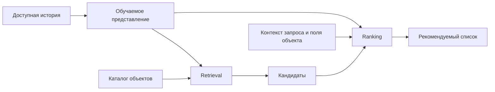

# Промышленная картина: состояние на октябрь 2026

## Воронка остаётся важной единицей проектирования

Схема `retrieval → предварительное ранжирование → ranking → выдача` распределяет
стоимость: дешёвые модели работают по большому каталогу, дорогие — по меньшему
числу кандидатов. В описании Instagram 2025 года по-прежнему есть sourcing,
early-stage ranking и late-stage ranking, много поверхностей и моделей.
Следовательно, нельзя утверждать, что вся индустрия перешла к одному Transformer.
[Официальная инженерная публикация Meta, май 2025](https://engineering.fb.com/2025/05/21/production-engineering/journey-to-1000-models-scaling-instagrams-recommendation-system/).

Диаграмма — обобщённая схема, не точная архитектура конкретной компании.
Трансформер может стоять в encoder, ranker или генераторе списка: это разные
уровни интеграции и разные основания для сравнения.

## Проверенные публичные примеры

| Система / источник | Что описано авторами | Что из этого следует для нас |
|---|---|---|
| [PinnerFormer, Pinterest, 2022](https://arxiv.org/abs/2205.04507) | Обучаемое пакетное представление истории, промышленное применение | Возможна замена ручного профиля без online-encoder на каждом запросе |
| [TransAct, Pinterest, 2023](https://arxiv.org/abs/2306.00248) | Transformer свежих действий вместе с пакетными представлениями в ranking | Промышленный путь может быть гибридным |
| [HSTU, Meta, 2024](https://arxiv.org/html/2402.17152v3) | Единая последовательная формулировка и специализированный encoder | Замена числовых агрегатов требует достаточного контекста и выразительности |
| [OneRec, Kuaishou, 2025](https://arxiv.org/abs/2502.18965) | Генерация сессии, MoE, reward/preference alignment; заявлено внедрение | Для воспроизведения нужны данные и цели уровня выдачи |
| [SORT, AliExpress, 2026](https://arxiv.org/abs/2603.03988v3) | Request-centric организация, local attention, pruning и pretraining; заявлен production | Архитектура должна учитывать стоимость множества кандидатов |
| [ReST, ByteDance, 2026](https://arxiv.org/abs/2609.01240v1) | Переиспользуемая история и лёгкий cross-decoder; заявлены A/B и deployment | Практичная идея: кодировать историю один раз на запрос |
| [TGR, Tencent, 2026](https://arxiv.org/abs/2609.00986v1) | Отдельные ветви ranking, генерации выдачи и reasoning; заявлены внедрения | Даже внутри одной программы нет единственного generative-подхода |
| [GEM, Meta, октябрь 2026](https://engineering.fb.com/2026/10/13/ml-applications/generative-ads-model-gem-scaling-frontier-ads-ai/) | Центральная foundation-модель, sequence/non-sequence взаимодействия, post-training и перенос знаний | Большая обучающая модель не обязана целиком исполняться в serving |

Строки о SORT/ReST/TGR отражают прежде всего статьи самих команд. A/B-эффекты
получены на закрытых данных и не проверены нами независимо. Их проценты нельзя
сравнивать между собой: отличаются базы, продукты, метрики и участки воронки.
Не переносим такие проценты на ожидаемое улучшение NDCG в KION.

## Что именно модель получает вместо счётчиков

Минимальный вход: ID исторического объекта, время, тип доступного действия,
поля объекта и контекст пользователя/запроса. Вектора этих полей становятся
токенами. Параметры attention и scoring обучаются совместно с embeddings.
В нашем KION нет полноценного потока разнотипных действий; добавлять фиктивные
impression/click-токены нельзя.

Ручная формула могла говорить: «суммировать похожие фильмы за семь дней».
Обучаемый механизм может взвесить историю в зависимости от кандидата, времени
и взаимодействий между историческими объектами. Он не обязан выучить именно
счётчик; это проверяемая способность, а не гарантия. Прямая постановка замены
числовых агрегатов последовательными данными описана в
[HSTU, §2.1](https://arxiv.org/html/2402.17152v3#S2.SS1).

При этом **личная история не содержит всю информацию глобальных агрегатов**.
Нашему CatBoost явно доступен свежий спрос по всем пользователям. Статичные веса
item embedding сами по себе не получают новые общесистемные события между
обновлениями модели. Для исследования полезно различать потерю этого сигнала
и неспособность архитектуры извлекать личные предпочтения. Потребуется отдельная
абляция глобальных признаков или модель свежего потока; это наша гипотеза.

## Главные инженерные ограничения

**Длина и повторение истории.** Обычный self-attention имеет квадратичную
стоимость по длине. Если каждый из C кандидатов заставляет повторять encoder,
цена возрастает ещё сильнее. Shared history encoder и недорогой candidate
cross-attention — обоснованный старт; соответствующее промышленное решение
подробно обсуждается в [ReST, §2.4–2.6](https://arxiv.org/html/2609.01240v1).

**Свежесть.** Важно не только когда произошёл event, но и когда он попал в
признаки/модель. Batch embeddings и realtime-sequences закрывают разные нужды;
online learning требует отдельной инфраструктуры.
[Monolith, ByteDance, 2022](https://arxiv.org/abs/2209.07663).

**Serving и кэши.** Кэширование вычислений истории, компиляция и GPU-ядра часто
определяют практическую пригодность большой модели. NVIDIA в сентябре 2026
показывает HSTU serving с AOTInductor, Dynamo-Triton и KV caching. Это пример
инфраструктуры с конкретными условиями замера, а не обязательный стек нашего проекта.
[Официальная публикация NVIDIA](https://developer.nvidia.com/blog/deploying-an-hstu-generative-recommender-with-nvidia-dynamo-triton/).

**Гетерогенность полей.** Таблицы ID, мультимодальные описания, временная история
и числовой контекст имеют разные свойства. В опубликованном GEM 2026 они остаются
различимыми sequence/non-sequence входами с обучаемым взаимодействием. Поэтому
«всё стало языком» — слишком сильное упрощение.
[GEM, раздел Efficient Architecture](https://engineering.fb.com/2026/10/13/ml-applications/generative-ads-model-gem-scaling-frontier-ads-ai/).

## Что остаётся ручной работой

Даже модель без агрегатов требует определения целевой переменной, доступного
каталога, временных срезов, negative sampling, масок, кодирования времени,
ограничений длины, дедупликации и метрик. При генеративном retrieval добавляются
кодирование объектов и ограничения декодирования. Полностью исчезнуть должна
не инженерия, а конкретная коллекция вручную придуманных статистик.

В большой production-системе дополнительно нужны правила доступности контента,
контроль качества логов и экспериментирование. Это описание требований системы,
не обещание воспроизвести закрытую инфраструктуру в учебном эксперименте.

## Почему не начинаем с промышленного репозитория целиком

В официальном HSTU-репозитории для большинства публичных конфигураций указана
карта с 24 GB+ памяти; проверенный авторами стек — Ubuntu 22.04, CUDA 12.4,
Python 3.10. Это не доказательство невозможности маленького HSTU на нашей карте,
но и не готовая инструкция для RTX 2060 и текущего Python 3.12.
[README Meta](https://github.com/meta-recsys/generative-recommenders).

[NVIDIA recsys-examples](https://github.com/NVIDIA/recsys-examples) и
[официальный модуль TransAct](https://github.com/pinterest/transformer_user_action)
полезны как инженерные ориентиры. Совместимость не проверялась, код не скачивался
для исполнения. Для первого эксперимента предлагается небольшая собственная
реализация с обычными attention-операциями и явным тестированием масок.
