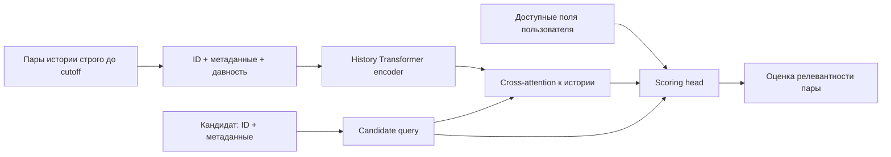

# План: обучаемая история вместо ручных агрегатов

Статус: предложение после обзора литературы; реализации и результатов пока нет.
Все размеры ниже — стартовые гиперпараметры, а не измеренные оптимумы.

## 1. Исследовательский вопрос

Можно ли из доступных ID, дат и категориальных полей автоматически получить
представления пары user–item, конкурентные ручным агрегатам CatBoost?
Раздельно проверяем качество признаков, качество нейросетевого ранжировщика
и качество retrieval. Не выдаём улучшение одного за доказательство другого.

Первая архитектура вдохновлена target-aware историей
[DIN](https://arxiv.org/abs/1706.06978), моделью будущего вовлечения
[PinnerFormer](https://arxiv.org/abs/2205.04507) и переиспользованием encoder в
[ReST](https://arxiv.org/abs/2609.01240). Это наша адаптация к данным, не репликация
какой-либо из этих систем.

## 2. Что известно про наш KION

Источник — полный русский `data_original.zip`, 5 476 251 строка, 15 963 объекта
в метаданных. На cutoff 2021-08-09 среди всех 850 489 пользователей с историей:

| Свойство | Значение |
|---|---:|
| Медиана длины истории | 2 |
| 90-й / 95-й / 99-й процентили | 13 / 20 / 46 |
| Пользователей с историей длиннее 128 | 588 |
| Доля строк в user–day группах с несколькими объектами | 54,64% |

Это статистика всей past-популяции, не только 30 000 dev-пользователей или
будущих активных пользователей метрики. Перед реализацией отдельно профилируем
именно обучающие и оцениваемые группы. Числа вычислены локально без чтения
итоговых меток; полный результат — [kion_profile.json](kion_profile.json).

Наблюдаем последнюю дату пары, а не все сеансы. Порядок внутри дня неизвестен.
Нельзя интерпретировать сортировку по item_id как причинную цепочку просмотров.
Ограничения исходного снимка сохраняются для всех моделей, см.
[аудит baseline](../../baseline/LEAKAGE_AUDIT.md).

## 3. Вход и архитектура первого решения

- Item ID embedding, отдельные embeddings категориальных значений и кодирование
  относительной даты. Для многозначных полей — обучаемый pooling над токенами.
  Никаких оконных счётчиков, cohort popularity, co-view графов или manual affinity
  на входе этой модели. Item/user IDs — категориальные данные, не агрегаты.
- History encoder: начать с 2 блоков, `d_model=64`, 2–4 heads, dropout 0.1.
  Отдельный пользовательский ID по умолчанию не нужен: модель кодирует историю,
  не запоминает только обученных пользователей.
- История кодируется один раз, затем каждый кандидат обращается к ней
  cross-attention. Кандидаты не должны видеть другие кандидаты через общий
  decoder-state: оценки проверяем на инвариантность к размеру scoring-батча.
- Для основного snapshot-encoder допустимо двунаправленное внимание между
  **всеми известными прошлыми** объектами: целевые недельные события в него
  не включаются. Это не тот же режим, что causal next-item supervision.
- Не использовать уникальные позиции внутри дня. Базовый вариант — time-aware
  set/history encoder без искусственного внутридневного порядка; отдельная
  абляция — SASRec-подобная модель с явно описанным разрешением ties.
  Вдохновение для order-invariant конструкции:
  [Set Transformer](https://arxiv.org/abs/1810.00825).
- Начать с `max_history=128`, обрабатывать динамическую длину и padding masks.
  Полный журнал хранится; обрезание — явное ограничение входа модели. Даже если
  затронуты немногие пользователи, сравнение с полными агрегатами не является
  равенством представленного контекста. Проверить full-history режим и отдельно
  сопоставить модели при одинаковом cap. Пограничный день не обрезать по item_id
  без документированной политики: либо включить целиком, либо исключить целиком.

## 4. Цель и обучение

Сначала сохранить недельный target baseline: новые наблюдаемые пары в
`[cutoff, cutoff+7d)`. Не подменять задачу угадыванием одного последнего объекта.

Пусть `C` — исходные кандидаты запроса, `P` — все недельные positives.
Первый loss для непустого `P∩C`:

`L = -mean_{i in P∩C} log softmax(scores(C))[i]`.

Это multi-positive softmax-задача на фиксированном наборе. Она не моделирует
полностью совместную вероятность будущего набора; BCE и pairwise loss — отдельные
абляции. Группы без positives в кандидатах не дают этому loss сигнала, но
обязательно остаются в итоговой оценке. Никогда не добавляем пропущенные positives
в оценочных кандидатов. Ненаблюдаемые пары — слабые negatives, не подтверждённые
отказы; без impression logs нельзя честно объявить задачу CTR-прогнозом.

Обучать только на трёх исходных train-срезах. Для более богатого обучения можно
добавить self-supervised префиксы, но это **отдельный режим**: каждый target
строго раньше 2021-08-09, вход строго раньше его даты; при совпадении дат
предсказывать следующую группу дня или исключать неоднозначные переходы.
Не учить «предыдущий item_id → следующий item_id» внутри одного дня.

Нужно разделить бюджеты данных:

1. **Контролируемый режим:** те же dev-user queries и временные окна, что у
   бустинга; metadata одинаковы. Его глобальные past-агрегаты доступны как часть
   baseline, но нейросеть их не получает.
2. **Расширенное pretraining:** обучение на past-действиях других пользователей
   может дать дополнительные supervised examples. Отчитываться отдельно:
   это уже меняет не только представления, но и объём supervision. При необходимости
   дообучить сопоставимый baseline на расширенных запросах.

Заморозка encoder перед CatBoost не делает обучающие embeddings честными
автоматически: encoder обучался на этих labels. Для строгого эксперимента
«нейропризнаки → бустинг» нужны временное разбиение pretraining/downstream
или temporal cross-fitting. Этот вариант не смешиваем с первым end-to-end скорером.

## 5. Последовательность экспериментов

| Этап | Вариант | Что проверяем |
|---|---|---|
| A | Item embeddings + простой обучаемый pooling / MLP | Достаточны ли embeddings без Transformer |
| B | История с временем → encoder → dot-product | Польза attention между прошлыми объектами |
| C | То же + candidate cross-attention | Польза зависимого от кандидата представления |
| D | C без времени / без метаданных / с другой маской | Что именно даёт качество |
| E | Изолированно обученные representations → CatBoost | Подходят ли нейропризнаки для исходной GBDT-задачи |
| F | Learned retrieval, при необходимости semantic IDs | Можно ли убрать ручные агрегаты из всей воронки |

HSTU-like блок — последующая архитектурная абляция после рабочего C.
Генерация Semantic IDs и DPO не входят в минимальный эксперимент: для первого
каталог невелик, для второго нет надёжного reward-сигнала целых выдач.
Это выбор масштаба исследования, не утверждение о бесполезности этих методов.

## 6. Честное сравнение

- В первом этапе заморозить train/validation кандидатов expanded-baseline,
  labels, IDs, даты и хеши. Ручные агрегаты в генераторе кандидатов при этом
  сохраняются: корректное утверждение — «ranker без ручных агрегатов».
- Метрики: macro NDCG@10, Recall@10, MAP@10, candidate recall, с теми же
  пользователями и знаменателем, включая retrieval misses. Не включать
  `positive+100 random negatives` в основной отчёт.
- Для F сравнивать обе модели на одинаковых новых кандидатах или полном
  допустимом каталоге. Прежние модели не переносить на новый candidate distribution
  без отдельного указания и, для полноценного сравнения, переобучения.
- Зафиксировать обычный train/validation протокол, early stopping, равный бюджет
  подбора, seeds 42/43/44. Парный bootstrap по пользователям плюс разброс seeds.
- Срезы по длине истории, новым объектам и давности активности. Разделить эффект
  отсутствия глобального тренда и личного моделирования: дополнительно оценить
  CatBoost без глобальных агрегатов. Основной сильный baseline не ослаблять.
- Время подготовки, обучения и scoring, peak VRAM/RAM, параметры, latency на
  пользователя и на пакет кандидатов; замеры прогреть и явно указать batch size.

Выбор кандидатов влияет на порядок качества моделей:
[On Sampled Metrics, 2020](https://research.google/pubs/on-sampled-metrics-for-item-recommendation/).

## 7. Контроль утечек и итоговый тест

И обучение, и pretraining, и словари/tokenizers обязаны иметь явно записанный
cutoff. `PAD/UNK`, cold-start и новые metadata tokens обрабатываются без чтения
будущих частот. Веса моделей и словари не дообучаются на validation labels.
Проверки: подмена будущего не меняет прошлый input, masks/padding, запрет target
в истории, инвариантность к порядку одного дня и составу scoring-пакета,
невключение holdout пользователей в supervised queries, хеши данных/кэшей.

Неделя 16–23 августа уже просмотрена в разработке baseline, включая резервных
пользователей. Поэтому честный результат на ней будет сопоставлением на известном
периоде, а не новым независимым финальным тестом. До выбора новой итоговой оценки
зафиксировать дизайн: непроверенная группа пользователей на той же неделе даст
лишь ограниченную проверку обобщения; действительно свежий временной период
потребует другого журнала/датасета. Не назначать новый holdout задним числом
на основании активности или успешности модели.

## 8. Практический старт реализации

Сначала сериализовать сырые past-последовательности и замороженные запросы,
написать tiny-fixture тесты и модель A. Затем B/C и короткий CPU smoke, после
этого GPU-launcher с логами по образцу baseline. Новые библиотеки пока не ставились.
Ориентир RTX 2060, FP32 как гарантированный старт; поддержку и выгоду FP16 проверять
замером, BF16 не предполагать. Первый batch size подобрать по реальной VRAM;
полное обучение и фактическую скорость заранее не обещать.

До получения результатов нельзя заключить, что Transformer воспроизвёл все
полезные агрегаты или победил baseline. Отрицательный результат тоже отвечает
исследовательскому вопросу, если протокол и доступная информация описаны точно.
